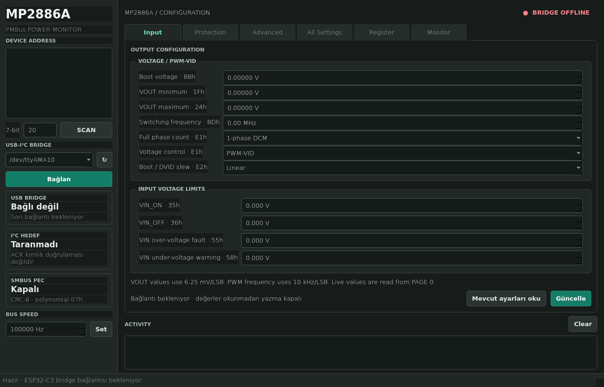
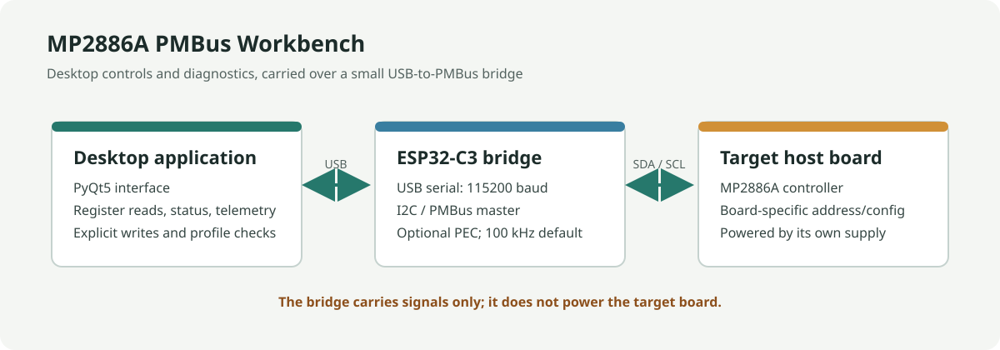
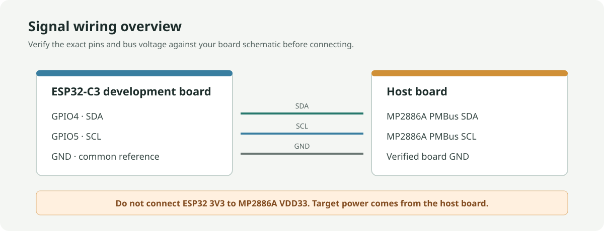

# MP2886A PMBus adapter

ESP32-C3 firmware and a small desktop utility for communicating with an MP2886A over PMBus/I2C. This is a general-purpose PMBus bridge, not an MPS factory configuration tool and not a replacement for an MPS-provided configuration image.



*Application overview; the screenshot shows the bridge disconnected and does not represent live hardware readings.*





> **Hardware safety:** The target board must be powered by its own supply. Connect only PMBus SDA, SCL, and a verified common ground. Do not connect ESP32 3V3 to the controller's VDD33 pin. Confirm bus voltage, pull-ups, pinout, and host-master isolation from the board schematic before connecting.

## Project contents

- `firmware/mp2886_bridge.ino`: ESP32-C3 USB-serial to I2C/PMBus bridge, with optional PEC handling.
- `pc/mp2886_qt.py`: PyQt5 configuration, diagnostics, register, and telemetry interface.
- `pc/mp2886_registers.py`: MP2886A Page 0 command catalog and verified format/status interpretations.
- `pc/mp2886_tool.py`: desktop application entry point.
- `requirements.txt`: Python runtime dependencies.

Local profile files matching `*-profile.json` are intentionally ignored by Git. A profile can contain board-specific configuration and identifiers; create and review your own profile from the application before using it. Do not publish a captured profile unless you have confirmed that its contents are safe to share.

## Capabilities

- Read the Page 0 register catalog and telemetry through an ESP32-C3 bridge.
- Display supported VIN/VOUT thresholds in engineering units and preserve undocumented manufacturer fields as raw codes.
- Diagnose standard PMBus status flags and show MPS fault snapshots.
- Change selected live settings with read-back verification; EEPROM storage remains a separate, explicit operation.
- Save/load board profiles locally, with configuration identity checks before applying values.

This project is not an MPS factory programming utility. It does not generate configuration codes, infer undocumented register meanings, or provide a universal profile for GPU/VR boards.

## Datasheet findings

- The MP2886A is a digital multi-phase PWM controller, not a standalone MOSFET gate driver. Its PWM outputs are intended to control compatible Intelli-Phase devices; it supports up to six phases.
- It has an on-chip EEPROM for storing and restoring device configurations. PMBus-programmable features include phase assignment, switching frequency, reference voltage, loop compensation, and fault parameters.
- The ordering code is `MP2886AGU-xxxx`; the four hexadecimal characters identify the register configuration stored in EEPROM. The datasheet says to work with an MPS FAE to create this unique identifier/configuration.
- PMBus SCL/SDA input thresholds are VIH >= 1.35 V and VIL <= 0.8 V. The datasheet lists a 10 kHz to 1 MHz operating range; this project defaults to 100 kHz.
- `STORE_USER_ALL` (15h) stores supported live configuration values to EEPROM. `RESTORE_USER_ALL` (16h) restores them. These are PMBus commands, not direct raw EEPROM address writes.
- A repair discussion on the MPS forum recommends a separate computing-products GUI and obtaining its correct configuration file from MPS. Therefore this project does not invent a full register profile or attempt to generate an MPS configuration code.

## Hardware

Use an ESP32-C3 development board with USB serial. Firmware defaults to SDA=GPIO4 and SCL=GPIO5; adjust `MP2886_SDA_PIN` and `MP2886_SCL_PIN` for your board.

| ESP32-C3 | Target board |
| --- | --- |
| GND | Ground (common reference) |
| SDA GPIO | MP2886A board SDA / PMBus SDA |
| SCL GPIO | MP2886A board SCL / PMBus SCL |

Do not connect ESP32 3V3 to the controller's VDD33 pin to power a motherboard. The MP2886A must be powered by its host board, and its bus pull-ups must be present at a compatible voltage. Check the bus voltage and schematic before connecting. Do not attach two active PMBus masters at once; isolate the host master if it can contend for the bus. Never connect to PWM outputs, switch nodes, or power-stage gate-drive pins.

The 7-bit address depends on the board's ADDR configuration. `0x20` was verified on the currently connected board; it is not guaranteed for every board. Scan the bus and confirm the address from the board schematic.

## Firmware

1. In Arduino IDE, install Espressif's ESP32 board support and select an ESP32-C3 board.
2. Open `firmware/mp2886_bridge.ino`, set the GPIO defines if needed, and upload.
3. If the board uses native USB CDC, enable USB CDC on boot in the board options.

The serial command set is `PING`, `SCAN`, `FREQ <Hz>`, `PEC ON/OFF`, `RB/RW <addr> <command>`, `WB/WW <addr> <command> <value>`, and `CMD <addr> <command>`. Addresses and values are hexadecimal except the bus frequency. Word operations transfer the low byte first, as required by SMBus/PMBus.

PEC is off by default. When enabled, the bridge appends CRC-8 (polynomial `0x07`, initial value `0`) to writes and checks the received PEC byte on reads. The desktop utility marks a read as verified only after that comparison succeeds. Confirm PEC support in the target controller/configuration before enabling it; a missing or incorrect PEC causes the read to fail.

The desktop utility's `VR / PGOOD oku` action reads PMBus `STATUS_WORD` (`79h`) and displays bit 11 (`POWER_GOOD#`) as a raw bit value. This is not an electrical measurement of a PGOOD pin, and the adapter still has no PGOOD or VOUT wire. The status command must be supported by the target configuration.

## Desktop utility

```sh
python3 -m venv .venv
. .venv/bin/activate
pip install -r requirements.txt
python pc/mp2886_tool.py
```

The utility is a PyQt5 desktop application using Qt's Fusion style with a dark theme. It includes the datasheet Page 0 command catalog: 154 commands with names, access types, and data widths; 147 are marked readable. Select a catalog entry to fill in its command and read width. `Oku` shows the current raw value and an interpretation where the datasheet format is verified. `Page 0 oku` first reads `PAGE` and proceeds only if it is already `00h`; it never changes the page and skips write-only and Send commands. The catalog does not include Page 2 or EEPROM Pages 28/29. Manufacturer-specific fields without a verified field-level decoder are shown as raw hexadecimal rather than guessed bit meanings. Register, diagnostic, and activity lists have independent clear controls.

The utility also supports I2C scanning, byte/word writes, bus-frequency selection, and explicit confirmation for EEPROM restore/store. Do not write values copied from another board profile.

The desktop workspace uses a device-address sidebar and Input, Protection, Advanced, All Settings, Register, and Monitor pages. After the bridge connects, it reads the curated Input/Protection fields, all 123 readable/writable Page 0 registers, and all 23 datasheet read-only registers. The same full reads are available on demand. Input exposes VOUT boot/min/max (VID, 6.25 mV/LSB), switching frequency (10 kHz/LSB), phase count, PWM-VID/PMBus control, linear/R-C slew mode, VIN_ON/VIN_OFF, VIN OVP fault limit, and VIN UV warning limit (the VIN thresholds use 0.125 V/LSB). Protection exposes output current warning, total OCP limit, and OT warning. Current limits use `TOTAL_CURRENT_RESOLUTION` in `MFR_SYS_CONFIG` (44h). All Settings presents every readable/writable Page 0 register as a named decimal control in a selectable functional group, with search. Verified fields use physical units and documented modes use choices; undocumented manufacturer fields use decimal register codes without guessed scales or bit meanings. Monitor contains telemetry and a separate read-only register view. The Protection diagnosis summary names each active standard status flag by register, bit, and description; nonzero MPS fault snapshots show their exact register and raw value. Update re-reads changed settings, writes only changed values, then reads them back. It does not modify EEPROM; `STORE_USER_ALL` remains a separate explicit action. `OT_WARN_LIMIT` (51h) is a warning, not an OTP cutoff. `MFR_VTEMP_OT_SET` (EAh) and `MFR_TSNS_OT_SET` (E9h) remain decimal register codes in All Settings because cutoff scaling depends on sensor configuration.

Monitor reads Power Good, status flags, and seven telemetry commands on demand or at a five-second interval. Measurements are converted using the MP2886A datasheet formats: VIN is 31.25 mV/LSB, VOUT is 1 mV/LSB, temperature is 0.1 °C/LSB, and efficiency is 0.195%/LSB. IOUT uses 0.25 A/LSB or 0.5 A/LSB; PIN and POUT use 0.5 W/LSB or 1 W/LSB. The current/power scales follow `TOTAL_CURRENT_RESOLUTION`, read from `MFR_SYS_CONFIG` (44h), bit 3. Invalid fixed/reserved bits are reported as format errors. If the resolution register cannot be read, current and power remain raw with an explanatory note. The monitor does not change `MFR_REPORT_CTRL`; PIN, POUT, and efficiency may reflect the configured average/latch reporting mode.

To create a profile, connect the ESP32-C3 bridge, select and scan the target address, then open the `Kayıtlar` tab and choose `Profili kaydet…`. The utility reads the readable/writable Page 0 configuration registers and saves a JSON file only if the complete read succeeds. To apply one, choose `Dosyadan yaz…` and select the profile from the same board/VR configuration. The utility checks `CONFIG_ID` and revision, asks for confirmation, writes each allowed register, and reads it back to verify. The profile does not include page, output-operation, protection/EEPROM controls, device identity, or PMBus address. Applying it changes live working values only; it does not store them in EEPROM. After testing on the exact board, use `EEPROM’a kaydet…` separately only if a persistent change is intended.

## Important limitation

Being able to issue `STORE_USER_ALL` does not mean a correct GPU/VR profile can be reconstructed. If the original configuration is missing or corrupted, obtain the exact profile for the board and MP2886A configuration from MPS or the board vendor before writing. EEPROM wear and power loss during a store are additional risks. Test first on a current-limited, non-production setup.

## References

- [MPS MP2886A datasheet](https://www.monolithicpower.com/en/documentview/productdocument/index/version/2/document_type/Datasheet/lang/en/sku/MP2886AGU/)
- [MPS MP2886A product page](https://www.monolithicpower.com/en/mp2886a.html)
- [MPS technical forum: MP2886A programming](https://forum.monolithicpower.com/t/mp2886a-prgramming/1985)
- [MP2886A datasheet HTML mirror](https://www.alldatasheet.com/html-pdf/2201241/MPS/MP2886A/62/1/MP2886A.html)